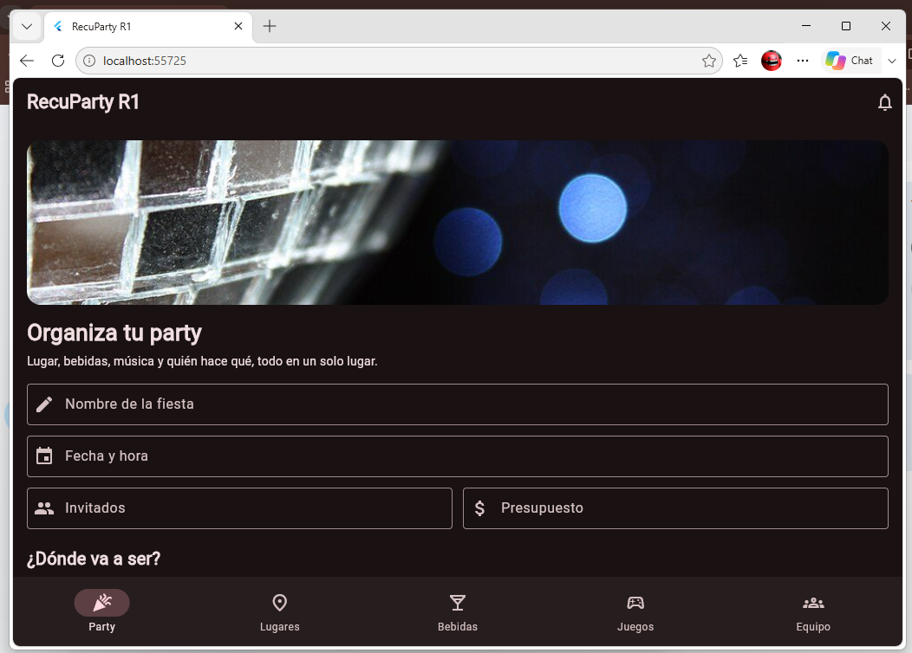
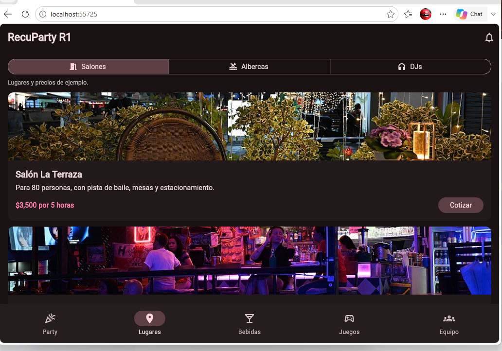
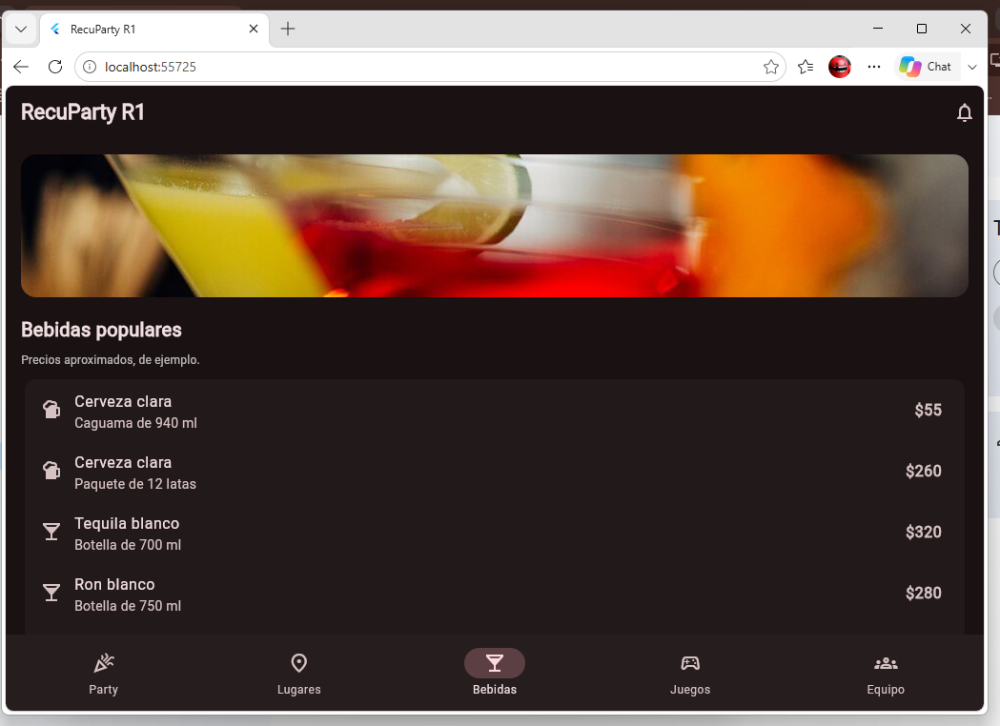
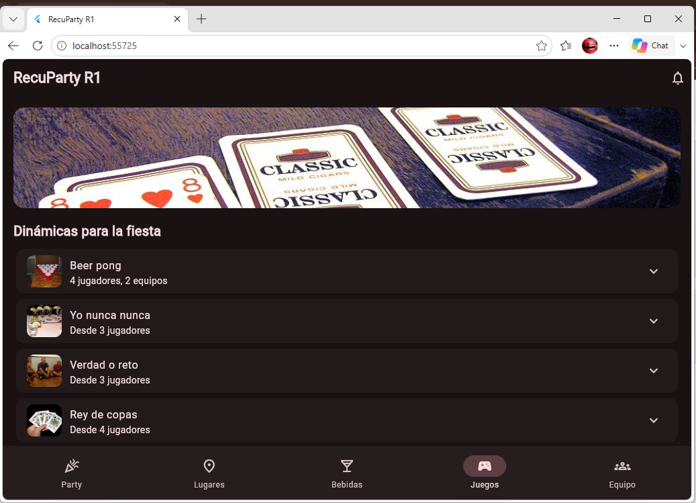
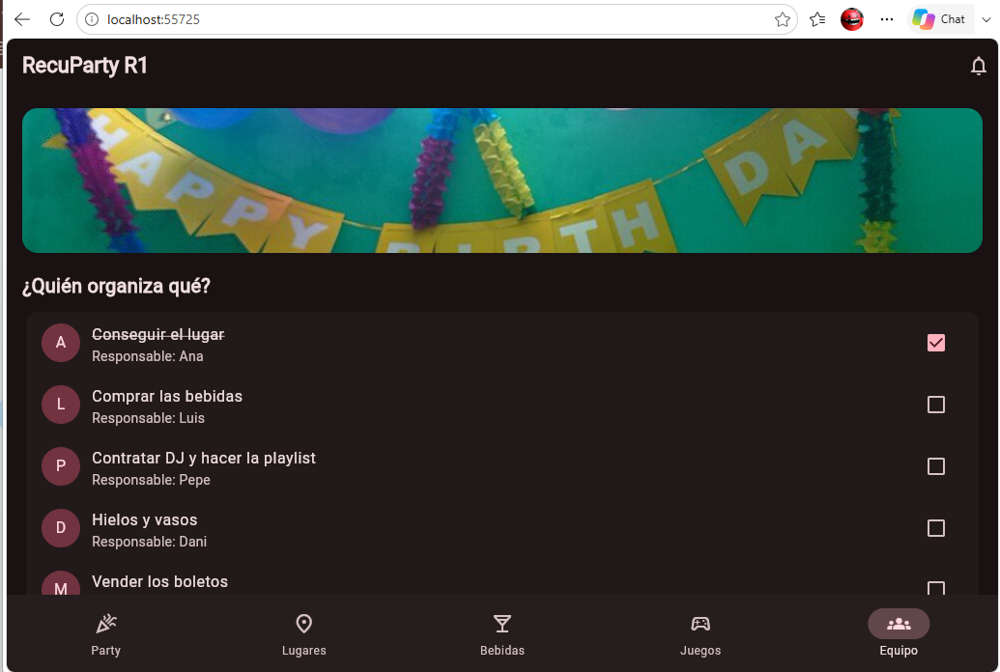
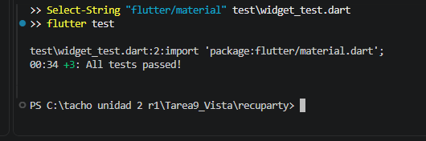

# RecuParty R1

Tarea 9: implementaci칩n de vista para proyecto (Flutter).

- Alumno: Oscar Manuel Ayala Ortiz
- N.C. 1225100784, grupo GTID244
- Materia: Desarrollo de Aplicaciones M칩viles
- Docente: Anastacio Rodr칤guez Garc칤a

## Qu칠 es

RecuParty R1 es una app para organizar fiestas. El nombre junta "recuperaci칩n 1" con "party". Esta tarea es solo la parte visual de la pantalla principal. Los datos son de ejemplo, no hay base de datos ni l칩gica de fondo.

La idea se va a seguir desarrollando m치s adelante.

## La pantalla

Es una sola pantalla con barra de navegaci칩n abajo y cinco pesta침as:

1. **Party:** formulario para organizar la fiesta (nombre, fecha, invitados, presupuesto, tipo de lugar, venta de boletos).
2. **Lugares:** salones, albercas y DJs con su precio.
3. **Bebidas:** bebidas populares con precio aproximado y recetas (agua loca, cuba libre, michelada y paloma).
4. **Juegos:** din치micas como beer pong, yo nunca nunca y karaoke, y una playlist de canciones populares.
5. **Equipo:** qui칠n organiza qu칠, con casillas, y la venta de boletos.

## Lo que pide la tarea

- Botones: crear party, compartir, cotizar, agregar, generar boletos.
- Campos de texto: nombre, fecha, invitados, presupuesto, nueva tarea, precio del boleto.
- Im치genes: una por pesta침a, en `assets/images/`.
- Barra de navegaci칩n: `NavigationBar` con las cinco pesta침as.
- Listas: lugares, bebidas, recetas, din치micas, canciones y tareas.

Todo el c칩digo est치 en un solo archivo: `lib/main.dart`.

## Evidencia de funcionamiento

| Party | Lugares | Bebidas |
|---|---|---|
|  |  |  |

| Juegos | Equipo |
|---|---|
|  |  |

## Aviso

La app es solo para mayores de 18 a침os. Los precios y lugares son inventados, de ejemplo.

## C칩mo correrlo

```
flutter pub get
flutter run -d chrome
```

## Pruebas autom磬icas

`flutter test` pasa las 3 pruebas de `test/widget_test.dart`: la barra de navegaci蚤 con las cinco pesta人s, los botones de la pesta人 Party y los tipos de lugar de la pesta人 Lugares.


